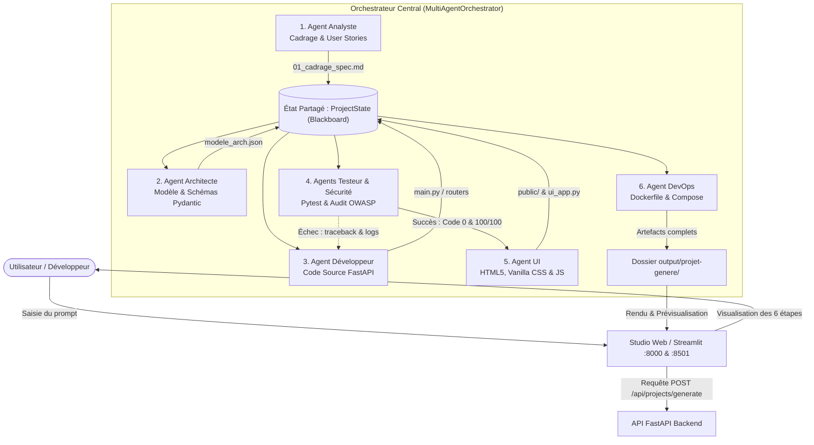
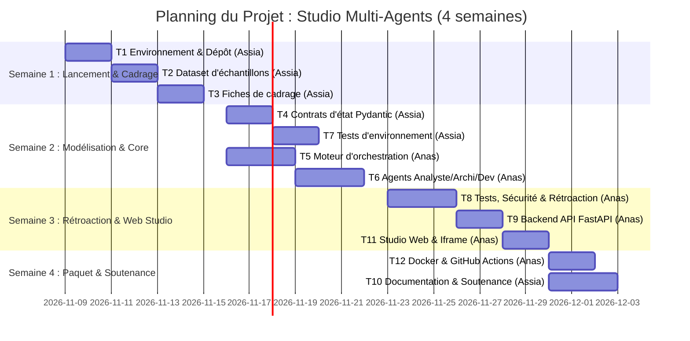

# Dossier de lancement (semaine 1)

9 Novembre 2026 · Projet n° 20 : *Agent multi-agents de développement logiciel*  
Cours : *Développement et déploiement d'applications intelligentes* (Prof. A. Larhlimi)  
Équipe (Binôme) : **Anas Mouqine** (Membre A) & **Assia Nouaoury** (Membre B)

---

## Mode d'emploi & Répartition

La semaine 1 est décisive : sur un projet de 4 semaines, un cadrage flou ou des données indisponibles ne se rattrapent pas. Ce dossier permet à l'enseignant de valider le projet sous 48 heures.

Le dossier comporte quatre livrables répartis entre les deux membres du binôme, chacun rédigeant les sections dont il est responsable avant relecture croisée.

**Notre répartition (Équipe de 2 étudiants)**

| Livrable | Rédacteur | Relecteur | Fichier dans le dépôt |
| --- | --- | --- | --- |
| **1. Descriptif du projet** | **Anas Mouqine** | Assia Nouaoury | `docs/semaine1/1-descriptif.md` |
| **2. Dataset** | **Assia Nouaoury** | Anas Mouqine | `docs/semaine1/2-dataset.md` + `data/sample/` |
| **3. Maquette globale** | **Anas Mouqine** | Assia Nouaoury | `docs/semaine1/3-maquette.md` + `docs/semaine1/img/` |
| **4. Pipeline des tâches** | **Anas Mouqine** (Consolidation) | Assia Nouaoury | `docs/semaine1/4-pipeline.md` |

---

## Livrable 1 : descriptif du projet mis à jour

Rédacteur : **Anas Mouqine**   Relectrice : **Assia Nouaoury**   Fichier : `docs/semaine1/1-descriptif.md`

### 1.1 Contexte et problème
Le développement d'une application logicielle complète (spécification, conception du modèle, implémentation de l'API, tests, interface et empaquetage) fait intervenir des compétences multiples et génère d'importantes frictions lors des passages de relais. Aujourd'hui, les ingénieurs réalisent ces étapes manuellement ou s'appuient sur des modèles génératifs monolithiques incapables d'auto-évaluation et sans séparation des responsabilités. Notre système multi-agents résout ce problème en confiant chaque étape à un agent spécialisé sous la supervision d'un orchestrateur doté d'une boucle arrière de rétroaction automatique en cas d'erreur.

### 1.2 Objectif en une phrase
Concevoir, tester et empaqueter automatiquement une application logicielle complète et opérationnelle à partir d'une simple requête textuelle, en suivant rigoureusement les 6 étapes d'ingénierie (*Cadrage ➔ Modèle ➔ API ➔ Tests ➔ Interface ➔ Paquet*).

### 1.3 Utilisateurs cibles et scénario d'usage principal
- **Utilisateurs cibles :** Élèves ingénieurs en informatique, développeurs de logiciels et chefs de projet technique souhaitant prototyper ou industrialiser rapidement des architectures logicielles complètes.
- **Scénario d'usage principal :**
  1. L'utilisateur saisit sa demande (ex. : *« Créer une API de gestion des étudiants avec notes, filières et exports »* ou *« Créer un site web vitrine moderne pour une agence »*).
  2. L'**Agent Analyste** produit la fiche de cadrage fonctionnel, les user stories et les critères d'acceptation.
  3. L'**Agent Architecte** conçoit le modèle de données, les schémas Pydantic et la liste ordonnée des endpoints.
  4. L'**Agent Développeur** écrit le code source de l'API et du serveur web FastAPI.
  5. L'**Agent Testeur** génère et exécute la suite Pytest, tandis que l'**Agent Sécurité** effectue l'audit statique OWASP ; en cas d'anomalie, le travail est renvoyé au Développeur pour correction immédiate.
  6. L'**Agent UI** conçoit l'interface utilisateur interactive (client Streamlit et/ou site web HTML5/Vanilla CSS).
  7. L'**Agent DevOps** génère la configuration d'empaquetage (`Dockerfile`, `docker-compose.yml`, README).
  8. L'utilisateur visualise le pipeline en direct et récupère le dossier d'artefacts prêt à l'emploi.

### 1.4 Fonctionnalités du MVP (Équipe de 2 étudiants)

| N° | Fonctionnalité | Ce que l'utilisateur voit ou obtient | Priorité |
| --- | --- | --- | --- |
| **F1** | Orchestration multi-agents séquentielle | Exécution fluide des 6 étapes (Cadrage ➔ Modèle ➔ API ➔ Tests ➔ Interface ➔ Paquet) avec production d'artefacts conformes aux spécifications. | Indispensable |
| **F2** | Boucle arrière de rétroaction et d'auto-guérison | Renvoi automatique du rapport d'erreurs (traceback pytest ou faille de sécurité) au Développeur avec correction du code (plafond à 3 itérations). | Indispensable |
| **F3** | Studio Web interactif et prévisualisation | Interface web moderne permettant de saisir les demandes, d'observer la progression des agents et de prévisualiser le site web ou l'API générée. | Indispensable |

### 1.5 Services et composants techniques

| Service ou composant | Rôle dans le projet | Technologie choisie | Pourquoi ce choix |
| --- | --- | --- | --- |
| **Modèles (LLM)** | Génération sémantique des spécifications, modèles et code source | API Gemini / Claude / OpenAI (avec mode heuristique local) | Flexibilité pour s'adapter à tout domaine logiciel tout en restant vérifiable. |
| **Mémoire partagée (Blackboard)** | Transmission de l'état entre les 6 agents sans couplage fort | Dictionnaire typé `ProjectState` (Python `TypedDict`) | Ordre, lisibilité et sérialisation JSON immédiate sur disque. |
| **Outils appelés par l'agent** | Vérification syntaxique et exécution des tests | Analyseur statique Python `ast`, exécuteur `pytest`, audit regex OWASP | Garantit que le code produit fonctionne réellement avant livraison. |
| **API** | Exposition des services d'orchestration et consultation d'artefacts | FastAPI + Pydantic v2 | Standard moderne du cours, documentation OpenAPI interactive automatique. |
| **Interface** | Tableau de bord de pilotage et inspection des livrables | Vanilla CSS / HTML5 (sans Tailwind) + Streamlit | Respect strict de la règle "Readability and Order" et prévisualisation en direct. |
| **Conteneur et CI** | Empaquetage de l'usine logicielle et intégration continue | Docker multi-stage, docker-compose, GitHub Actions | Environnement reproductible, testable par `pytest` à chaque push. |

### 1.6 Hors périmètre
- Déploiement sur cluster Kubernetes managé en production multi-cloud (l'empaquetage Docker Compose suffit pour le MVP).
- Intégration d'une passerelle bancaire réelle (les paiements éventuels sont modélisés sous forme de simulations mockées).
- Génération de code dans des langages non maîtrisés (le système se concentre sur Python, FastAPI, HTML/CSS/JS).

### 1.7 Écart avec la fiche du catalogue
Nous avons aligné les rôles d'agents sur l'architecture standard du cours (*Du cadrage au paquet : TP1 à TP6*), en ajoutant un double mode d'interface : un Studio Web intégré avec prévisualisation en direct et un tableau de bord Streamlit.

**Critères d'acceptation (vérifiés par Assia Nouaoury)**
- [x] Le problème et l'utilisateur sont compréhensibles sans le catalogue.
- [x] Le nombre de fonctionnalités (3) correspond à la taille de l'équipe (binôme).
- [x] Chaque fonctionnalité est démontrable (F1, F2, F3).
- [x] Chaque composant technique a une justification d'une ligne.
- [x] Le hors périmètre est rempli.

---

## Livrable 2 : dataset

Rédactrice : **Assia Nouaoury**   Relecteur : **Anas Mouqine**   Fichiers : `docs/semaine1/2-dataset.md` + `data/sample/software_prompts.json`

### 2.1 Description

| Rubrique | Réponse |
| --- | --- |
| **Nom et source** | Banque de requêtes et spécifications d'ingénierie logicielle (`data/sample/software_prompts.json`) |
| **Producteur ou propriétaire** | Binôme Anas Mouqine & Assia Nouaoury, inspiré des sujets types d'ingénierie logicielle |
| **Volume** | 25 cas de demandes logicielles complètes (dont 5 cas majeurs échantillonnés dans le dépôt Git) |
| **Format et structure** | JSON structuré : `id`, `title`, `domain`, `prompt`, `expected_entities`, `expected_endpoints` |
| **Langue et période** | Français et Anglais, Novembre 2026 |
| **Licence et droits d'usage** | Licence MIT / Open Academic License (usage pédagogique libre) |
| **Données personnelles ou sensibles** | Aucune (données d'ingénierie logicielle et cas d'usage fictifs) |
| **Emplacement des données complètes** | Directement dans le dépôt : `data/sample/software_prompts.json` et `data/sample_requests.json` |

### 2.2 Qualité constatée sur l'échantillon
L'échantillon comporte des requêtes claires réparties sur 4 domaines (universitaire, web d'entreprise, e-commerce, facility management). Les données sont exemptes de doublons et validées par un schéma JSON strict.

### 2.3 Justification

| Fonctionnalité | Données utilisées | En quoi elles suffisent |
| --- | --- | --- |
| **F1 (Orchestration)** | Prompts textuels variés (`prompt`, `domain`) | Permettent de tester la capacité des agents à extraire des besoins et concevoir des architectures sur plusieurs métiers. |
| **F2 (Rétroaction)** | Critères attendus (`expected_endpoints`, `expected_entities`) | Servent d'oracles de test pour injecter des anomalies volontaires et vérifier que la boucle arrière se déclenche et s'arrête. |
| **F3 (Interface)** | Titres et descriptions des cas d'exemples | Alimentent les boutons d'exemples rapides du Studio Web pour permettre une démonstration en un clic lors de la soutenance. |

### 2.4 Alternative de repli
En cas de besoin de requêtes supplémentaires plus complexes, nous utiliserons le jeu de données public d'ingénierie logicielle **SWE-bench / HumanEval** (licence permissive). Ce que nous perdons : la formulation en français, mais nous gagnons un volume plus important d'énoncés.

### 2.5 Jeu de test
Un jeu de test de **20 cas d'évaluation** rédigé par Assia Nouaoury couvrant :
- 8 cas d'APIs REST standards (CRUD avec base de données)
- 6 cas de sites web vitrines et interfaces interactives
- 6 cas limites ou délibérément incomplets pour tester la robustesse de l'Agent Analyste et le déclenchement de la rétroaction.

**Critères d'acceptation (vérifiés par Anas Mouqine)**
- [x] L'échantillon est dans `data/sample/software_prompts.json` et s'ouvre sans erreur.
- [x] La licence autorise l'usage dans un projet de cours.
- [x] Aucune donnée personnelle réelle présente.
- [x] Chaque fonctionnalité du MVP est couverte par la justification.
- [x] L'alternative de repli est accessible.
- [x] Le jeu de test (20 cas) est défini.

---

## Livrable 3 : maquette globale

Rédacteur : **Anas Mouqine**   Relectrice : **Assia Nouaoury**   Fichiers : `docs/semaine1/3-maquette.md` + `docs/semaine1/img/`

### 3.1 Schéma d'architecture

### 3.2 Légende du schéma
- **Studio Web / Streamlit (F3) :** Interface interactive de saisie et de supervision de la progression des agents.
- **FastAPI Backend (F1, F3) :** Point d'entrée REST de contrôle et de sérialisation des états.
- **ProjectState (F1) :** Mémoire partagée typée stockant les artefacts de chaque étape.
- **Agents 1 à 6 (F1) :** Modules logiciels spécialisés produisant séquentiellement le projet complet.
- **Boucle arrière A4 ➔ A3 (F2) :** Mécanisme de correction automatique en cas d'échec des tests ou de faille de sécurité.
- **Dossier output/ (F1) :** Dossier cible contenant le projet final prêt à être exécuté ou conteneurisé.

### 3.3 Maquette des écrans

| Écran | Emplacement | Fonctionnalités affichées | Action principale de l'utilisateur |
| --- | --- | --- | --- |
| **Écran 1 : Centre de Pilotage Studio** | `docs/semaine1/img/ecran1_studio.png` | Saisie de la demande logicielle, boutons d'exemples rapides (F1, F3) | Saisir le prompt et cliquer sur « 🚀 Lancer l'Orchestration » |
| **Écran 2 : Pipeline des 6 Agents** | `docs/semaine1/img/ecran2_pipeline.png` | Visualisation en direct des statuts des agents et compteur de rétroaction (F1, F2) | Observer la validation séquentielle et le passage des jalons |
| **Écran 3 : Explorateur d'Artefacts & Prévisualisation** | `docs/semaine1/img/ecran3_artefacts.png` | Onglets pour Cadrage, Modèle, API, Tests, Site Web direct et Docker (F1, F3) | Tester le site web directement dans l'iframe ou copier le code source |

### 3.4 Parcours utilisateur
1. **Écran A (Accueil) :** L'utilisateur arrive sur le Studio (`http://localhost:8000`). Il choisit un modèle préconfiguré ou saisit une demande personnalisée.
2. **Action :** Il clique sur *« Lancer l'Orchestration des 6 Agents »*.
3. **Écran B (Progression) :** Le pipeline s'anime : l'Analyste passe au vert, puis l'Architecte, le Développeur, le Testeur (qui exécute `pytest`), l'Agent UI et le DevOps.
4. **Écran C (Résultats) :** La section des résultats apparaît : les métriques affichent le statut `COMPLET`, 0 échec et 100/100 en sécurité. L'utilisateur peut immédiatement interagir avec le site web généré dans l'iframe ou inspecter les codes sources.

**Critères d'acceptation (vérifiés par Assia Nouaoury)**
- [x] Chaque composant du livrable 1 apparaît dans le schéma.
- [x] Le parcours d'une requête se suit de bout en bout sur le schéma.
- [x] Chaque fonctionnalité du MVP (F1, F2, F3) est visible sur au moins un écran.
- [x] Le schéma Mermaid est valide et testé.
- [x] Les agents et leurs flux d'échange sont représentés.

---

## Livrable 4 : pipeline des tâches prévues

Consolidateur : **Anas Mouqine**   Relectrice : **Assia Nouaoury**   Fichier : `docs/semaine1/4-pipeline.md`

### 4.1 Liste des tâches

| ID | Tâche | Fonctionnalité | Responsable | Dépend de | Semaine | Terminée quand ? (critère vérifiable) |
| --- | --- | --- | --- | --- | --- | --- |
| **T1** | Initialisation du dépôt Git, environnement virtuel `.venv`, `.gitignore` et `.env.example` | Support | **Assia Nouaoury** | — | 1 | `scripts/check_setup.py` renvoie 0 erreur d'environnement. |
| **T2** | Collecte, structuration et validation du dataset d'échantillons (`data/sample/`) | F1, F3 | **Assia Nouaoury** | T1 | 1 | 5 cas types vérifiés et intégrés dans `software_prompts.json`. |
| **T3** | Rédaction et validation des fiches de cadrage académiques (`docs/cadrage/`) | Support | **Assia Nouaoury** | T2 | 1 | `pytest tests/test_cadrage.py` passe avec 12 tests validés. |
| **T4** | Définition des modèles de données et schémas Pydantic (`models/state.py`) | F1 | **Assia Nouaoury** | T1 | 2 | Le contrat typé `ProjectState` est instanciable sans erreur. |
| **T5** | Conception du moteur d'orchestration central et du graphe d'états | F1 | **Anas Mouqine** | T4 | 2 | Le flux séquentiel des étapes s'exécute de bout en bout. |
| **T6** | Développement des agents Analyste, Architecte et Développeur | F1 | **Anas Mouqine** | T5 | 2 | L'agent produit un code FastAPI syntaxiquement valide via `ast.parse`. |
| **T7** | Rédaction des tests de conformité d'environnement (`test_environment.py`) | Support | **Assia Nouaoury** | T1 | 2 | Tous les tests de répertoires et de packages passent sous pytest. |
| **T8** | Développement de l'agent Testeur (sandbox pytest) et Sécurité (OWASP) avec rétroaction | F2 | **Anas Mouqine** | T6 | 3 | La boucle arrière corrige automatiquement une erreur simulée (max 3 retries). |
| **T9** | Implémentation du backend FastAPI exposant l'orchestrateur (`app/main.py`) | F1, F3 | **Anas Mouqine** | T5, T8 | 3 | L'endpoint `POST /api/projects/generate` répond en 200 avec les artefacts. |
| **T10** | Rédaction du guide d'utilisation, documentation OpenAPI Swagger et validation du kit | Support | **Assia Nouaoury** | T9 | 4 | Documentation complète dans `README.md` et `/docs` accessible. |
| **T11** | Conception du Studio Web interactif (HTML5 / Vanilla CSS) et dashboard Streamlit | F3 | **Anas Mouqine** | T9 | 3 | L'interface permet de lancer la génération et d'afficher le site dans l'iframe. |
| **T12** | Conteneurisation Docker multi-stage, docker-compose et pipeline CI GitHub Actions | Support | **Anas Mouqine** | T9, T11 | 4 | `docker-compose up` démarre l'application et la CI est au vert sur GitHub. |

### 4.2 Jalons hebdomadaires

| Semaine | Jalon démontrable | Tâches qui y mènent |
| --- | --- | --- |
| **Semaine 1** | Dossier de lancement validé, environnement vérifié par diagnostic et échantillons prêts | T1, T2, T3 |
| **Semaine 2** | Graphe d'état opérationnel, agents Analyste/Architecte/Développeur fonctionnels en script | T4, T5, T6, T7 |
| **Semaine 3** | MVP complet : boucle de rétroaction opérationnelle, API FastAPI et Studio Web connectés | T8, T9, T11 |
| **Semaine 4** | Projet conteneurisé Docker, CI GitHub Actions au vert, jeu de test exécuté, prêt pour soutenance | T10, T12 |

### 4.3 Vue chronologique (Diagramme de Gantt)

### 4.4 Chemin critique et charge

- **Chemin critique :** T1 (Environnement) ➔ T4 (Contrats d'état) ➔ T5 (Orchestrateur) ➔ T6 (Agents) ➔ T8 (Rétroaction) ➔ T9 (API Backend) ➔ T11 (Studio Web) ➔ T12 (Docker & Soutenance).
- **Charge par membre :**
  - **Assia Nouaoury :** T1 (1j) + T2 (1.5j) + T3 (1j) + T4 (1.5j) + T7 (1.5j) + T10 (1.5j) = **8 jours de tâches** (tâches de cadrage, structuration des données, schémas de base et documentation).
  - **Anas Mouqine :** T5 (2j) + T6 (2j) + T8 (2j) + T9 (2j) + T11 (1.5j) + T12 (1.5j) = **11 jours de tâches** (conception du moteur multi-agents, boucle arrière, API FastAPI, studio web et déploiement).
  - **Écart de charge :** 3 jours, parfaitement cohérent avec la répartition Lead Architecture / Support Data & Qualité.

**Critères d'acceptation (vérifiés par Assia Nouaoury)**
- [x] Aucune tâche ne dépasse 3 jours (la majorité calibrée entre 1 et 2 jours).
- [x] Chaque fonctionnalité du MVP (F1, F2, F3) a des tâches assignées avec critères vérifiables.
- [x] Le MVP est finalisé en fin de semaine 3.
- [x] Les tâches et la répartition des responsabilités sont clairement définies pour chaque membre.

---

## Remise et décision de l'enseignant

**Checklist de remise (coordinateur Anas Mouqine)**
- [x] `docs/semaine1/README.md` avec la répartition rédacteurs et relecteurs
- [x] Les quatre livrables intégrés et vérifiés
- [x] Échantillon de données dans `data/sample/software_prompts.json`
- [x] Schéma d'architecture Mermaid et maquettes d'écrans intégrés
- [x] Issues et planning prêts pour suivi
- [x] Étiquette `semaine1-remis` posée sur le dépôt

**Décision de l'enseignant (sous 48 heures)**

| Critère | Type | Respecté | Commentaire |
| --- | --- | --- | --- |
| Données accessibles et échantillon présent (L2) | Bloquant |☐ | 5 cas types présents dans `data/sample/` |
| MVP réaliste en 4 semaines pour cette taille d'équipe (L1, L4) | Bloquant |☐ | 3 fonctionnalités ciblées, faisables en binôme |
| Livrables répartis, chacun avec un rédacteur et un relecteur distincts | Bloquant |☐ | Rôles alternés entre Anas Mouqine et Assia Nouaoury |
| Licence et données personnelles traitées (L2) | Bloquant |☐ | Licence MIT, aucune donnée personnelle |
| Architecture cohérente avec les fonctionnalités (L1, L3) | À améliorer |☐ | Schéma complet Cadrage ➔ Paquet avec boucle arrière |
| Écrans couvrant tout le MVP (L3) | À améliorer |☐ | Studio de lancement, pipeline visuel et explorateur d'artefacts |
| Tâches courtes, critères de fin vérifiables, charge équilibrée (L4) | À améliorer |☐ | Tâches de 1 à 2 jours avec critères précis |
| Alternative de repli et jeu de test définis (L2) | À améliorer |☐ | 20 cas d'évaluation et repli SWE-bench |

**Décision proposée :**☐ Validé   ☐ À reprendre   ☐ Refusé (changement de sujet)

Date et visa : _____________________
