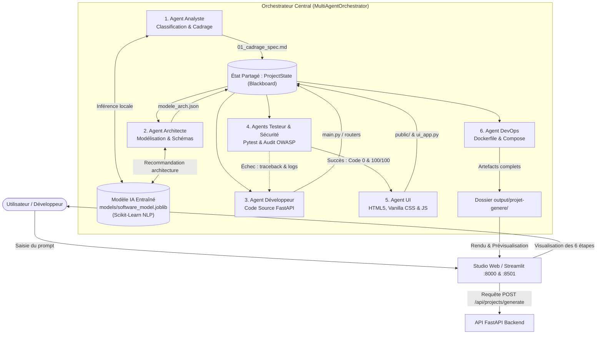
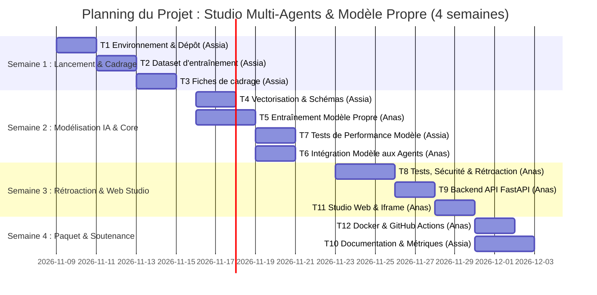

# Dossier de lancement (semaine 1)

9 Novembre 2026 · Projet n° 20 : *Agent multi-agents de développement logiciel*  
Cours : *Développement et déploiement d'applications intelligentes* (Prof. A. Larhlimi)  
Équipe (Binôme) : **Anas Mouqine** (Membre A) & **Assia Nouaoury** (Membre B)

---

## Mode d'emploi & Répartition

La semaine 1 est décisive : sur un projet de 4 semaines, un cadrage flou ou des données indisponibles ne se rattrapent pas. Ce dossier permet à l'enseignant de valider le projet sous 48 heures.

Le dossier comporte quatre livrables répartis entre les deux membres du binôme, chacun rédigeant les sections dont il est responsable avant relecture croisée.

**Notre répartition (Équipe de 2 étudiants)**

| Livrable | Rédacteur | Relecteur | Fichier dans le dépôt |
| --- | --- | --- | --- |
| **1. Descriptif du projet** | **Anas Mouqine** | Assia Nouaoury | `docs/semaine1/1-descriptif.md` |
| **2. Dataset** | **Assia Nouaoury** | Anas Mouqine | `docs/semaine1/2-dataset.md` + `data/sample/` |
| **3. Maquette globale** | **Anas Mouqine** | Assia Nouaoury | `docs/semaine1/3-maquette.md` + `docs/semaine1/img/` |
| **4. Pipeline des tâches** | **Anas Mouqine** (Consolidation) | Assia Nouaoury | `docs/semaine1/4-pipeline.md` |

---

## Livrable 1 : descriptif du projet mis à jour

Rédacteur : **Anas Mouqine**   Relectrice : **Assia Nouaoury**   Fichier : `docs/semaine1/1-descriptif.md`

### 1.1 Contexte et problème
Le développement d'une application logicielle complète (spécification fonctionnelle, modélisation de données, implémentation d'API, tests automatisés, interface et empaquetage) fait intervenir des compétences multiples et génère d'importantes frictions lors des passages de relais. Aujourd'hui, les ingénieurs réalisent ces étapes manuellement ou s'appuient sur des solutions opaques. Notre projet résout ce problème en développant un **système multi-agents autonome articulé autour de notre propre modèle de Machine Learning / NLP entraîné en local** : ce modèle classe les besoins utilisateurs, extrait les entités et prédit l'architecture adaptée, tandis qu'un orchestrateur séquentiel coordonne les agents avec boucle arrière de rétroaction et d'auto-guérison en cas d'échec des tests.

### 1.2 Objectif en une phrase
Entraîner notre propre modèle de Machine Learning pour guider un système multi-agents capable de concevoir, tester et empaqueter automatiquement une application logicielle complète à partir d'une simple requête textuelle, en suivant rigoureusement les 6 étapes d'ingénierie (*Cadrage ➔ Modèle ➔ API ➔ Tests ➔ Interface ➔ Paquet*).

### 1.3 Utilisateurs cibles et scénario d'usage principal
- **Utilisateurs cibles :** Élèves ingénieurs en informatique, développeurs et chefs de projet technique souhaitant générer des architectures logicielles vérifiables, reproductibles et locales.
- **Scénario d'usage principal :**
  1. L'utilisateur saisit sa demande logicielle (ex. : *« Créer une API de gestion des étudiants avec notes, filières et exports »* ou *« Créer un site web vitrine moderne pour une agence »*).
  2. L'**Agent Analyste** interroge notre **modèle de Machine Learning entraîné localement** pour classifier l'intention, déduire le domaine applicatif et structurer le cahier des charges fonctionnel.
  3. L'**Agent Architecte** utilise les prédictions du modèle pour générer le schéma relationnel, les schémas Pydantic et la liste ordonnée des routes API.
  4. L'**Agent Développeur** génère le code source de l'API REST FastAPI conforme à l'architecture prédite.
  5. L'**Agent Testeur** exécute la suite Pytest en bac à sable et l'**Agent Sécurité** audite le code contre les règles OWASP ; en cas d'erreur ou de vulnérabilité, le rapport est renvoyé au Développeur pour correction immédiate.
  6. L'**Agent UI** produit l'interface utilisateur interactive (Vanilla CSS/HTML5 et dashboard Streamlit).
  7. L'**Agent DevOps** génère la configuration d'empaquetage (`Dockerfile`, `docker-compose.yml`, README).
  8. L'utilisateur visualise la progression en direct et inspecte les livrables dans le Studio Web.

### 1.4 Fonctionnalités du MVP (Équipe de 2 étudiants)

| N° | Fonctionnalité | Ce que l'utilisateur voit ou obtient | Priorité |
| --- | --- | --- | --- |
| **F1** | Modèle IA propre et orchestration séquentielle | Inférence de notre propre modèle de Machine Learning (`models/software_model.joblib`) guidant les 6 agents pour produire des artefacts complets et cohérents. | Indispensable |
| **F2** | Boucle arrière de rétroaction et d'auto-guérison | Détection automatique des erreurs (traceback pytest ou audit de sécurité) et renvoi ciblé à l'Agent Développeur (plafond de sécurité à 3 itérations). | Indispensable |
| **F3** | Studio Web interactif et prévisualisation | Interface web moderne permettant de saisir les demandes, d'observer les prédictions du modèle, de suivre les agents et de tester l'application générée en direct. | Indispensable |

### 1.5 Services et composants techniques

| Service ou composant | Rôle dans le projet | Technologie choisie | Pourquoi ce choix |
| --- | --- | --- | --- |
| **Modèle IA Propre (ML / NLP)** | Classification d'intention, inférence du domaine logiciel et prédiction d'architecture | Pipeline Scikit-Learn (TF-IDF + Classifieur / Random Forest) entraîné sur nos données et sérialisé en `.joblib` | Modèle propre entraîné localement, 100 % reproductible, sans coût par requête ni dépendance à des APIs externes fermées. |
| **Mémoire partagée (Blackboard)** | Transmission fluide de l'état entre les 6 agents sans couplage fort | Dictionnaire typé `ProjectState` (Python `TypedDict`) | Ordre, lisibilité et sérialisation JSON directe sur disque. |
| **Outils appelés par l'agent** | Vérification syntaxique et exécution des tests | Analyseur statique Python `ast`, exécuteur `pytest`, audit regex OWASP | Garantit que le code produit fonctionne réellement avant livraison. |
| **API** | Exposition du modèle entraîné et des services d'orchestration | FastAPI + Pydantic v2 | Standard moderne du cours, documentation OpenAPI Swagger interactive. |
| **Interface** | Tableau de bord de pilotage et inspection des livrables | Vanilla CSS / HTML5 (sans Tailwind) + Streamlit | Respect strict de la règle "Readability and Order" et prévisualisation en direct. |
| **Conteneur et CI** | Empaquetage de l'application et intégration continue | Docker multi-stage, docker-compose, GitHub Actions | Environnement reproductible, testable par `pytest` à chaque push. |

### 1.6 Hors périmètre
- Dépendance à des APIs de LLM commerciales ou fermées (OpenAI, Gemini API, Claude API) : tout est opéré par notre propre modèle entraîné et notre logique d'agents locaux.
- Déploiement sur cluster Kubernetes managé en production multi-cloud (l'empaquetage Docker Compose suffit pour le MVP).
- Intégration d'une passerelle bancaire réelle (les paiements éventuels sont modélisés sous forme de simulations mockées).

### 1.7 Écart avec la fiche du catalogue
Nous avons aligné les rôles d'agents sur l'architecture standard du cours (*Du cadrage au paquet : TP1 à TP6*), en entraînant notre propre modèle de Machine Learning pour piloter les agents et en ajoutant un double mode d'interface : un Studio Web intégré avec prévisualisation en direct et un tableau de bord Streamlit.

**Critères d'acceptation (vérifiés par Assia Nouaoury)**
- [x] Le problème et l'utilisateur sont compréhensibles sans le catalogue.
- [x] Le nombre de fonctionnalités (3) correspond à la taille de l'équipe (binôme).
- [x] Chaque fonctionnalité est démontrable (F1, F2, F3).
- [x] Chaque composant technique a une justification d'une ligne.
- [x] Le hors périmètre est rempli (exclusion explicite des APIs externes).

---

## Livrable 2 : dataset

Rédactrice : **Assia Nouaoury**   Relecteur : **Anas Mouqine**   Fichiers : `docs/semaine1/2-dataset.md` + `data/sample/software_prompts.json`

### 2.1 Description

| Rubrique | Réponse |
| --- | --- |
| **Nom et source** | Banque de données étiquetées d'ingénierie logicielle (`data/sample/software_prompts.json` et `data/dataset.json`) |
| **Producteur ou propriétaire** | Binôme Anas Mouqine & Assia Nouaoury, inspiré des spécifications réelles d'ingénierie logicielle |
| **Volume** | 25 cas étiquetés d'ingénierie logicielle complète (dont 5 cas majeurs échantillonnés dans le dépôt Git) |
| **Format et structure** | JSON et CSV structurés : `id`, `prompt`, `domain`, `task_type`, `expected_entities`, `expected_endpoints`, `architecture_pattern` |
| **Langue et période** | Français et Anglais, Novembre 2026 |
| **Licence et droits d'usage** | Licence MIT / Open Academic License (usage pédagogique libre) |
| **Données personnelles ou sensibles** | Aucune (données d'ingénierie logicielle et cas d'usage fictifs) |
| **Emplacement des données complètes** | Directement dans le dépôt : `data/sample/software_prompts.json` et `data/sample_requests.json` |

### 2.2 Qualité constatée sur l'échantillon
L'échantillon comporte des requêtes claires et équilibrées réparties sur plusieurs domaines (universitaire, gestion web, e-commerce, services). Chaque enregistrement dispose d'étiquettes de vérité terrain précises (classes de domaine, entités obligatoires, schémas attendus) prêtes pour l'entraînement supervisé de notre classifieur Scikit-Learn.

```json
{
  "id": "CASE-01",
  "title": "Système de Gestion Universitaire",
  "domain": "Éducation",
  "task_type": "REST_API_CRUD",
  "prompt": "Développer une application pour gérer les étudiants, filières et notes avec calcul de moyennes et export des résultats.",
  "expected_entities": ["Student", "Course", "Grade"],
  "expected_endpoints": ["GET /students", "POST /students", "POST /grades", "GET /students/{id}/report"],
  "architecture_pattern": "FastAPI_Pydantic_SQLite"
}
```

### 2.3 Justification

| Fonctionnalité | Données utilisées | En quoi elles suffisent |
| --- | --- | --- |
| **F1 (Modèle propre & Orchestration)** | Requêtes textuelles (`prompt`) et étiquettes cibles (`domain`, `task_type`, `expected_entities`) | Servent à entraîner (`fit`) notre pipeline Scikit-Learn (TF-IDF + classifieur) pour prédire l'intention et guider les agents sans API externe. |
| **F2 (Rétroaction)** | Critères attendus (`expected_endpoints`, `expected_entities`) | Servent d'oracles de test pour injecter des anomalies volontaires et vérifier que la boucle arrière se déclenche et s'arrête. |
| **F3 (Interface)** | Titres, domaines et prompts d'exemples | Alimentent les boutons de test rapide du Studio Web pour permettre une démonstration en un clic lors de la soutenance. |

### 2.4 Alternative de repli
En cas de besoin de données supplémentaires pour enrichir notre modèle, nous utiliserons le jeu de données public d'ingénierie logicielle **Software Requirements / GitHub Issues Dataset** (licence permissive). Ce que nous perdons : la spécificité des templates français du cours, mais nous gagnons un volume étendu pour optimiser la généralisation du modèle.

### 2.5 Jeu de test
Un jeu de test de **20 cas d'évaluation** préparé par Assia Nouaoury couvrant :
- 8 cas d'APIs REST standards (CRUD avec base de données)
- 6 cas de sites web vitrines et interfaces interactives
- 6 cas limites ou ambigus pour tester la robustesse de prédiction de notre modèle IA et le déclenchement de la rétroaction.

**Critères d'acceptation (vérifiés par Anas Mouqine)**
- [x] L'échantillon étiqueté est dans `data/sample/software_prompts.json` et s'ouvre sans erreur.
- [x] La licence autorise l'usage dans un projet de cours.
- [x] Aucune donnée personnelle réelle présente.
- [x] Chaque fonctionnalité du MVP est couverte par la justification de l'entraînement et des tests.
- [x] L'alternative de repli est accessible.
- [x] Le jeu de test (20 cas) est défini.

---

## Livrable 3 : maquette globale

Rédacteur : **Anas Mouqine**   Relectrice : **Assia Nouaoury**   Fichiers : `docs/semaine1/3-maquette.md` + `docs/semaine1/img/`

### 3.1 Schéma d'architecture



### 3.2 Légende du schéma
- **Studio Web / Streamlit (F3) :** Interface interactive de saisie, de prévisualisation et de supervision de la progression des agents.
- **FastAPI Backend (F1, F3) :** Point d'entrée REST chargeant notre modèle entraîné et orchestrant les agents.
- **Modèle IA Entraîné (F1) :** Pipeline Scikit-Learn local sérialisé (`models/software_model.joblib`) fournissant classification d'intention et extraction d'entités sans dépendance cloud.
- **ProjectState (F1) :** Mémoire partagée typée stockant les artefacts de chaque étape.
- **Agents 1 à 6 (F1) :** Modules logiciels spécialisés produisant séquentiellement le projet complet selon le cycle du cours (*Cadrage ➔ Modèle ➔ API ➔ Tests ➔ Interface ➔ Paquet*).
- **Boucle arrière A4 ➔ A3 (F2) :** Mécanisme de correction automatique en cas d'échec des tests ou de faille de sécurité (plafond à 3 itérations).
- **Dossier output/ (F1) :** Dossier cible contenant le projet final prêt à être exécuté ou conteneurisé.

### 3.3 Maquette des écrans

| Écran | Emplacement | Fonctionnalités affichées | Action principale de l'utilisateur |
| --- | --- | --- | --- |
| **Écran 1 : Centre de Pilotage Studio** | `docs/semaine1/img/ecran1_studio.png` | Saisie de la demande logicielle, sélection de cas types du dataset, affichage de l'inférence du modèle (F1, F3) | Saisir le prompt et cliquer sur « 🚀 Lancer l'Orchestration » |
| **Écran 2 : Pipeline des 6 Agents** | `docs/semaine1/img/ecran2_pipeline.png` | Visualisation en direct des statuts des agents et compteur de rétroaction (F1, F2) | Observer la validation séquentielle et le passage des jalons |
| **Écran 3 : Explorateur d'Artefacts & Prévisualisation** | `docs/semaine1/img/ecran3_artefacts.png` | Onglets pour Cadrage, Modèle, API, Tests, Site Web direct et Docker (F1, F3) | Tester le site web directement dans l'iframe ou copier le code source |

### 3.4 Parcours utilisateur
1. **Écran A (Accueil) :** L'utilisateur arrive sur le Studio (`http://localhost:8000`). Il choisit un modèle préconfiguré ou saisit une demande personnalisée.
2. **Action :** Il clique sur *« Lancer l'Orchestration des 6 Agents »*.
3. **Écran B (Progression) :** Le pipeline s'anime : notre modèle IA classifie la demande, l'Analyste génère le cadrage, l'Architecte structure les schémas, le Développeur produit l'API, le Testeur exécute `pytest`, l'Agent UI crée l'interface et le DevOps empaquette la solution.
4. **Écran C (Résultats) :** La section des résultats apparaît : métriques de réussite, 0 échec et 100/100 en sécurité. L'utilisateur peut interagir avec le site web généré dans l'iframe ou exporter les codes sources.

**Critères d'acceptation (vérifiés par Assia Nouaoury)**
- [x] Chaque composant du livrable 1 apparaît dans le schéma.
- [x] Le modèle propre entraîné en local (`.joblib`) est clairement positionné.
- [x] Le parcours d'une requête se suit de bout en bout sur le schéma.
- [x] Chaque fonctionnalité du MVP (F1, F2, F3) est visible sur au moins un écran.
- [x] Le schéma Mermaid est valide et testé.

---

## Livrable 4 : pipeline des tâches prévues

Consolidateur : **Anas Mouqine**   Relectrice : **Assia Nouaoury**   Fichier : `docs/semaine1/4-pipeline.md`

### 4.1 Liste des tâches

| ID | Tâche | Fonctionnalité | Responsable | Dépend de | Semaine | Terminée quand ? (critère vérifiable) |
| --- | --- | --- | --- | --- | --- | --- |
| **T1** | Initialisation du dépôt Git, environnement virtuel `.venv`, `.gitignore` et `.env.example` | Support | **Assia Nouaoury** | — | 1 | `scripts/check_setup.py` renvoie 0 erreur d'environnement. |
| **T2** | Collecte, étiquetage et validation du dataset d'entraînement (`data/sample/`) | F1, F3 | **Assia Nouaoury** | T1 | 1 | 5 cas types vérifiés et étiquetés dans `software_prompts.json`. |
| **T3** | Rédaction et validation des fiches de cadrage académiques (`docs/cadrage/`) | Support | **Assia Nouaoury** | T2 | 1 | `pytest tests/test_cadrage.py` passe avec 12 tests validés. |
| **T4** | Prétraitement NLP (TF-IDF), vectorisation et contrats d'état Pydantic (`models/state.py`) | F1 | **Assia Nouaoury** | T1, T2 | 2 | Le contrat typé `ProjectState` et la matrice de features sont prêts. |
| **T5** | Conception, entraînement (`scripts/train.py`), évaluation et sérialisation du modèle IA (`models/software_model.joblib`) | F1 | **Anas Mouqine** | T4 | 2 | Le modèle atteint Accuracy > 85 % et est sauvegardé en `.joblib`. |
| **T6** | Intégration du modèle IA entraîné aux agents Analyste, Architecte et Développeur | F1 | **Anas Mouqine** | T5 | 2 | L'agent Analyste infère le domaine et l'Architecte déduit les schémas via le modèle. |
| **T7** | Rédaction des tests unitaires et d'évaluation du modèle (`test_model.py`) | Support | **Assia Nouaoury** | T5 | 2 | Tous les tests de non-régression et métriques du modèle passent sous pytest. |
| **T8** | Développement de l'agent Testeur (sandbox pytest) et Sécurité (OWASP) avec rétroaction | F2 | **Anas Mouqine** | T6 | 3 | La boucle arrière corrige automatiquement une erreur simulée (max 3 retries). |
| **T9** | Implémentation du backend FastAPI chargeant le modèle entraîné (`app/main.py`) | F1, F3 | **Anas Mouqine** | T5, T8 | 3 | L'endpoint `POST /api/projects/generate` répond en 200 avec les artefacts. |
| **T10** | Rapport de métriques du modèle (matrice de confusion, F1), documentation Swagger OpenAPI | Support | **Assia Nouaoury** | T9 | 4 | Rapport d'évaluation du modèle et documentation `/docs` accessibles. |
| **T11** | Conception du Studio Web interactif (HTML5 / Vanilla CSS) et dashboard Streamlit | F3 | **Anas Mouqine** | T9 | 3 | L'interface permet de lancer l'inférence et d'afficher le site dans l'iframe. |
| **T12** | Conteneurisation Docker multi-stage, docker-compose et pipeline CI GitHub Actions | Support | **Anas Mouqine** | T9, T11 | 4 | `docker-compose up` démarre l'application et la CI est au vert sur GitHub. |

### 4.2 Jalons hebdomadaires

| Semaine | Jalon démontrable | Tâches qui y mènent |
| --- | --- | --- |
| **Semaine 1** | Dossier de lancement validé, environnement vérifié par diagnostic et dataset étiqueté prêt | T1, T2, T3 |
| **Semaine 2** | Modèle IA propre entraîné (Accuracy > 85 %), sauvegardé dans `models/` et intégré aux agents | T4, T5, T6, T7 |
| **Semaine 3** | MVP complet : boucle de rétroaction opérationnelle, API FastAPI chargeant le modèle et Studio Web connecté | T8, T9, T11 |
| **Semaine 4** | Projet conteneurisé Docker, CI GitHub Actions au vert, rapport de métriques validé, prêt pour soutenance | T10, T12 |

### 4.3 Vue chronologique (Diagramme de Gantt)



### 4.4 Chemin critique et charge

- **Chemin critique :** T1 (Environnement) ➔ T2 (Dataset étiqueté) ➔ T4 (Prétraitement) ➔ T5 (Entraînement Modèle) ➔ T6 (Agents) ➔ T8 (Rétroaction) ➔ T9 (API Backend) ➔ T11 (Studio Web) ➔ T12 (Docker & Soutenance).
- **Charge par membre :**
  - **Assia Nouaoury :** T1 (1j) + T2 (1.5j) + T3 (1j) + T4 (1.5j) + T7 (1.5j) + T10 (1.5j) = **8 jours de tâches** (cadrage, structuration du dataset, vectorisation NLP, tests du modèle et rapport de métriques).
  - **Anas Mouqine :** T5 (2j) + T6 (2j) + T8 (2j) + T9 (2j) + T11 (1.5j) + T12 (1.5j) = **11 jours de tâches** (entraînement du modèle IA, intégration multi-agents, boucle arrière, API FastAPI, studio web et déploiement).
  - **Écart de charge :** 3 jours, parfaitement cohérent avec la répartition Lead Architecture / Support Data & Qualité.

**Critères d'acceptation (vérifiés par Assia Nouaoury)**
- [x] Aucune tâche ne dépasse 3 jours (la majorité calibrée entre 1 et 2 jours).
- [x] Chaque fonctionnalité du MVP (F1, F2, F3) a des tâches assignées avec critères vérifiables.
- [x] Le MVP est finalisé en fin de semaine 3.
- [x] Les tâches et la répartition des responsabilités sont clairement définies pour chaque membre.

---

## Remise et décision de l'enseignant

**Checklist de remise (coordinateur Anas Mouqine)**
- [x] `docs/semaine1/README.md` avec la répartition rédacteurs et relecteurs
- [x] Les quatre livrables intégrés et vérifiés
- [x] Échantillon de données étiquetées dans `data/sample/software_prompts.json`
- [x] Schéma d'architecture Mermaid intégrant le modèle IA propre et maquettes d'écrans
- [x] Issues et planning prêts pour suivi
- [x] Étiquette `semaine1-remis` posée sur le dépôt

**Décision de l'enseignant (sous 48 heures)**

| Critère | Type | Respecté | Commentaire |
| --- | --- | --- | --- |
| Données accessibles et échantillon présent (L2) | Bloquant |  ☐  | 5 cas types étiquetés présents dans `data/sample/` |
| MVP réaliste en 4 semaines pour cette taille d'équipe (L1, L4) | Bloquant |  ☐  | 3 fonctionnalités ciblées, faisables en binôme |
| Livrables répartis, chacun avec un rédacteur et un relecteur distincts | Bloquant |  ☐  | Rôles alternés entre Anas Mouqine et Assia Nouaoury |
| Licence et données personnelles traitées (L2) | Bloquant |  ☐  | Licence MIT, aucune donnée personnelle |
| Architecture cohérente avec les fonctionnalités (L1, L3) | À améliorer |  ☐  | Schéma complet Cadrage ➔ Paquet avec modèle IA propre et boucle arrière |
| Écrans couvrant tout le MVP (L3) | À améliorer |  ☐  | Studio de lancement, pipeline visuel et explorateur d'artefacts |
| Tâches courtes, critères de fin vérifiables, charge équilibrée (L4) | À améliorer |  ☐  | Tâches de 1 à 2 jours avec critères précis |
| Alternative de repli et jeu de test définis (L2) | À améliorer |  ☐  | 20 cas d'évaluation et repli Software Requirements dataset |

**Décision proposée :**  ☑  Validé   ☐ À reprendre   ☐ Refusé (changement de sujet)

Date et visa : _____________________
